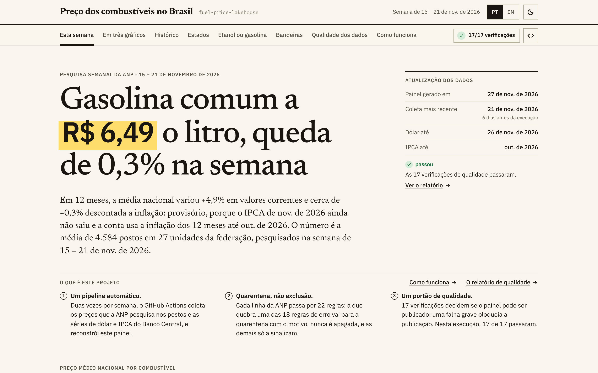
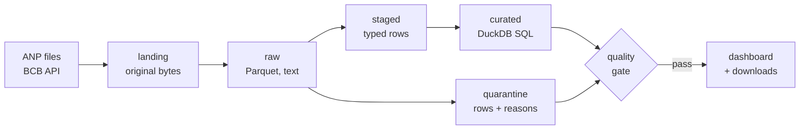
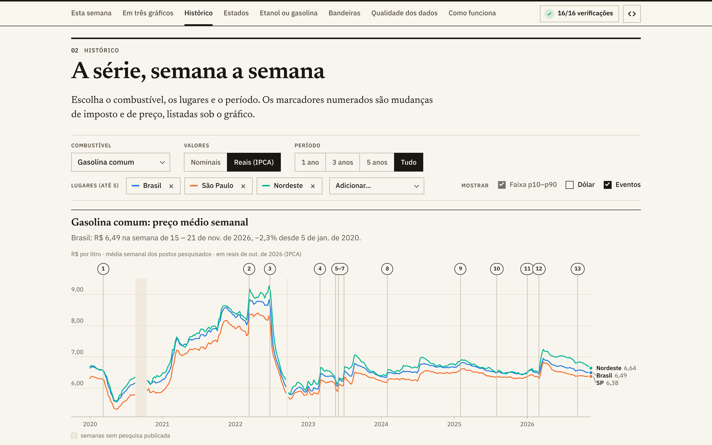
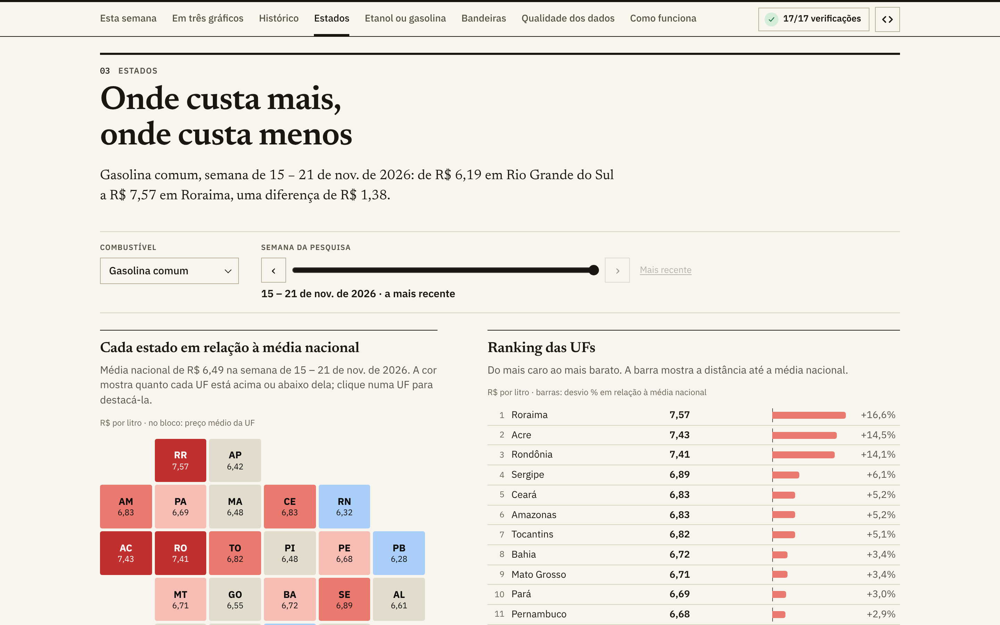
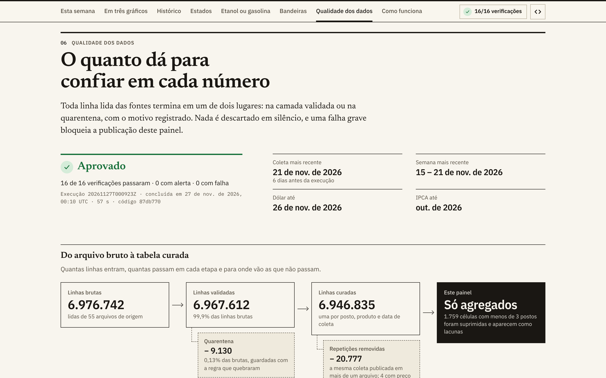
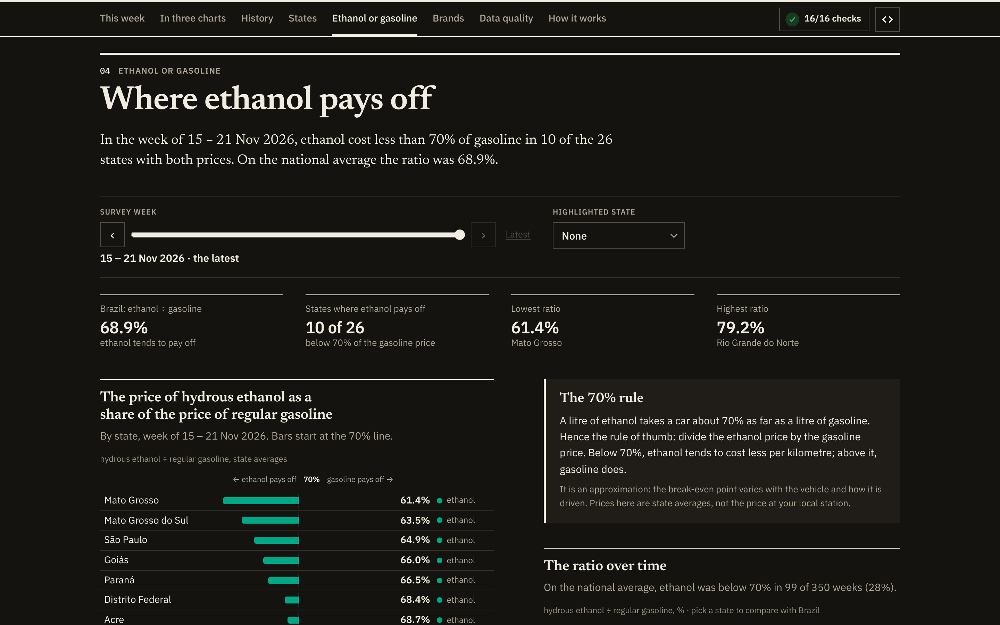

# fuel-price-lakehouse

[](https://github.com/Corrar/fuel-price-lakehouse/actions/workflows/ci.yml)
[](https://github.com/Corrar/fuel-price-lakehouse/actions/workflows/pipeline.yml)
[](LICENSE)

**Nearly seven million fuel prices from every Brazilian state, collected,
validated and published automatically twice a week, with a public data
quality report.**

**[Open the dashboard →](https://corrar.github.io/fuel-price-lakehouse/)**

[](https://corrar.github.io/fuel-price-lakehouse/)

## Why this exists

What fuel costs in Brazil moves inflation, freight and household budgets, and
ANP (the national petroleum agency) surveys it at thousands of stations every
week. The data is open, but it is published as hundreds of irregular CSV and
ZIP files: names that change from month to month, the same week published in
three different files, a file in another encoding, blank rows, formats that
change without notice.

This project turns that into weekly price series that can be trusted:

- **Automated end to end.** A scheduled GitHub Actions run collects only what
  is new, validates every row, rebuilds the tables, checks the result and
  publishes the dashboard. No server, no paid service, no manual step.
- **Every row accounted for.** Rows that break a rule are quarantined with the
  reason, never dropped; the row counts reconcile from the source files to the
  published tables.
- **Checked against the source.** For the week of 15 to 21 November 2026, the
  municipal averages computed here match ANP's own weekly summary for
  **2,505 of 2,506** municipality-fuel pairs, to the cent
  ([how](docs/validation.md)).

## In numbers

| | |
| --- | ---: |
| Station-level prices since January 2020 | 6.9 million |
| Stations / municipalities surveyed | 41,196 / 499 |
| Survey weeks | 350 |
| Source files collected (ANP and Banco Central) | 55 |
| Rows quarantined, with the rule they broke | 9,130 |
| Validation rules (ANP + Banco Central) / dataset checks | 22 + 5 / 17 |
| Automated tests (none touch the network) | 586 |
| A full run when nothing new was published (collection included) | about 1.5 minutes |

## How it works



1. **Collect** (`collect/`): the ANP landing page is read on every run and
   file names are never built from dates. A file already collected costs a
   one-byte range request; it is downloaded again only when its size or the
   "updated" date on ANP's page changes, and its SHA-256 then decides whether
   the content really changed. The first Tuesday run of each month downloads
   everything again, to catch a republication that kept the same size. Every
   download is kept byte for byte in a content-addressed landing zone, so the
   raw layer can be rebuilt without the network.
2. **Stage** (`stage/`): 27 rules (22 for ANP rows, 5 for Banco Central rows),
   each with an id, a severity and a description in English and Portuguese,
   judge the rows; a row that breaks an error rule is quarantined, a warning
   only flags it. A Pandera contract checks the result. Only files whose
   content changed are processed again.
3. **Curate** (`curate/`): DuckDB SQL removes the repetition between ANP's
   files, buckets prices into ANP survey weeks, aggregates them by country,
   region, state and flag type, and deflates them by IPCA. Aggregates built
   from fewer than three stations are not published.
4. **Report** (`quality/`): 17 dataset checks roll up into pass, warn or
   fail. A failed error check is a circuit breaker: nothing is published and
   the dashboard keeps showing the last good run. A failed warning check is
   reported, and the run is still published.
5. **Publish** (`site/`): a static dashboard on GitHub Pages and the public
   tables as Parquet and CSV downloads.

More in [`docs/architecture.md`](docs/architecture.md).

## Engineering choices worth a look

- **Idempotent and incremental.** Running the pipeline again with nothing new
  downloads nothing and rebuilds byte-identical tables; only the run's own
  record (build time, quality report, history line) is rewritten. An
  interrupted run resumes where it stopped. The manifest records every source
  file's hash, and the versions it replaced.
- **Quarantine, not delete.** `rows read = rows staged + rows quarantined`,
  for every file, enforced by the code
  ([ADR 0003](docs/decisions/0003-validation-and-quarantine.md)).
- **Contracts at every boundary.** The staged tables, the curated tables and
  the dashboard's data files each have a schema checked before anything is
  written.
- **Only aggregates are published.** Station-level data stays in the data
  folder of the machine that runs the pipeline (on GitHub, the Actions cache
  between runs) and is never uploaded as a release asset or a page; a test
  fails if a public table gains a station column. Cells with fewer than three
  stations are left out, which keeps a single station's price off the
  dashboard but is not a formal disclosure-control guarantee
  ([ADR 0002](docs/decisions/0002-what-is-published.md)).
- **Least privilege in CI.** The scheduled run builds with read-only access;
  separate jobs publish the release, deploy the site and keep the schedule
  alive, each with only the permission it needs; every action is pinned to a
  commit.
- **Documentation that cannot drift.** The [rules](docs/quality-rules.md) and
  the [data dictionary](docs/data-dictionary.md) are generated from the code,
  and a test fails when they are stale.
- **Measured before built.** Every quirk the code handles was first found in
  the real files and written down in [`docs/sources.md`](docs/sources.md).

## The dashboard

Portuguese by default, English on demand, light and dark, every view shareable
by link. It shows:

- the latest week at a glance: national averages, weekly and yearly change, in
  nominal and inflation-adjusted terms;
- price history since 2020 for any fuel, for Brazil, a region or several
  states, with the dollar for comparison and dated policy events;
- a tile map of the 27 states for any week, with a ranking;
- whether ethanol is worth it against gasoline in each state (the 70 % rule
  of thumb);
- branded against white-flag stations;
- the data quality report: the row funnel, every rule and check, every source
  file, and the history of runs.

| | |
| --- | --- |
|  |  |
|  |  |

## Run it yourself

Requires [uv](https://docs.astral.sh/uv/).

```sh
make install                 # the virtualenv, from the lockfile
make pipeline                # collect (about 600 MB the first time), validate, build, check
uv run python -m http.server -d build/site 8000   # then open http://localhost:8000
```

`make pipeline SINCE=2024-01` starts the history later. Each step also runs on
its own (`make extract`, `stage`, `curate`, `report`, `site`); `make help`
lists them. `make check` runs what CI runs: ruff, mypy, the tests and the
static checks of the front-end. After a run, `uv run python
tools/validate_against_anp.py <weekly summary>.xlsx` repeats the check against
ANP's own figures ([validation](docs/validation.md)).

To run the schedule from a fork, set **Settings → Pages → Source** to
**GitHub Actions** once; the workflow does the rest with the token GitHub
provides, without any secret.

## Repository layout

```
src/fuel_price_lakehouse/
  collect/    landing page discovery, HTTP with retries, manifest, landing zone, raw layer
  stage/      rule engine, ANP and Banco Central rules, incremental driver
  curate/     table registry and contracts, DuckDB SQL (sql/*.sql)
  quality/    dataset checks, quality report, run history
  site/       data files for the dashboard, downloads; static/ is the front-end
  cli.py      fuel-lakehouse: one subcommand per step, and run for all of them
tests/        pytest, against a fake ANP site and a fake Banco Central API
tools/        the check against ANP's weekly summary; static checks of the front-end
docs/         sources, architecture, validation, decisions, generated references
.github/      CI on every push; the scheduled pipeline
```

Stack: Python 3.12, uv, httpx, tenacity, pandas, Pandera, PyArrow, DuckDB,
pytest, ruff, mypy; Observable Plot and D3 on the front-end; GitHub Actions
and GitHub Pages.

## Documentation

| Document | What it covers |
| --- | --- |
| [`docs/sources.md`](docs/sources.md) | The two sources as measured: URLs, formats, volumes, limits, licences, quirks |
| [`docs/architecture.md`](docs/architecture.md) | Layers, state files and what each step guarantees |
| [`docs/validation.md`](docs/validation.md) | The curated figures checked against ANP's own weekly summary |
| [`docs/quality-rules.md`](docs/quality-rules.md) | Every row-level rule (generated) |
| [`docs/data-dictionary.md`](docs/data-dictionary.md) | Every curated table and column (generated) |
| [`docs/decisions/`](docs/decisions/) | Why: storage between runs, what is published, validation and quarantine, the static dashboard |

The project was built in reviewed stages, one pull request each:
[sources and foundation](https://github.com/Corrar/fuel-price-lakehouse/pull/1),
[collection](https://github.com/Corrar/fuel-price-lakehouse/pull/4),
[staged layer](https://github.com/Corrar/fuel-price-lakehouse/pull/5),
[curated tables and quality report](https://github.com/Corrar/fuel-price-lakehouse/pull/6),
[dashboard and schedule](https://github.com/Corrar/fuel-price-lakehouse/pull/7).

## Data sources and licences

- **ANP — Série Histórica de Preços de Combustíveis.** No licence is declared
  for this dataset; Decreto 8.777/2016 makes federal open data free to use with
  credit to the source. This project publishes **aggregates only**, always
  credited ([details](docs/sources.md#16-licence)).
- **Banco Central do Brasil — SGS** (series 1, dollar exchange rate; series
  433, IPCA).

This project is not affiliated with ANP or Banco Central do Brasil. Its
averages are simple means over the surveyed stations and differ slightly from
ANP's sales-weighted state and national bulletins. ANP surveys a sample of
stations that changes a little every week (about 80 % of them recur from one
week to the next), so small weekly moves include sampling effects.

## License

The code is released under the [MIT License](LICENSE).

---

## Resumo em português

**Quase sete milhões de preços de combustíveis de todo o Brasil, coletados,
validados e publicados automaticamente duas vezes por semana, com relatório de
qualidade público.** [Abra o painel →](https://corrar.github.io/fuel-price-lakehouse/)

A ANP publica os preços pesquisados em milhares de postos toda semana, mas em
centenas de arquivos irregulares (nomes que mudam, a mesma semana em três
arquivos, codificações diferentes, linhas em branco). Este pipeline
transforma isso em séries semanais confiáveis:

- **Automático de ponta a ponta**: um fluxo agendado no GitHub Actions baixa só
  o que é novo, valida cada linha, reconstrói as tabelas, confere a qualidade e
  publica o painel, sem servidor nem custo.
- **Nenhuma linha some**: o que quebra uma regra vai para a quarentena com o
  motivo, e as contagens fecham do arquivo de origem até a tabela publicada.
- **Conferido com a fonte**: na semana de 15 a 21/11/2026, as médias
  municipais calculadas aqui batem com o resumo semanal oficial da ANP em
  2.505 de 2.506 pares município-combustível, ao centavo.
- **Só agregados**: nada por posto é publicado; os dados por posto ficam na
  pasta de dados de quem roda o pipeline (no GitHub, no cache do Actions entre
  as execuções).

Para rodar: `make install` e `make pipeline`. A documentação técnica está em
inglês, na pasta [`docs/`](docs/).
