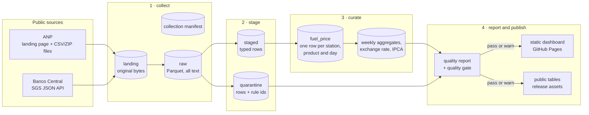

# Architecture

How data moves from the two public sources to the dashboard, what each step
keeps on disk, and what makes a run safe to repeat. The facts about the
sources are in [`sources.md`](sources.md); the decisions behind the design are
in [`decisions/`](decisions/).

`fuel-lakehouse run` executes the five steps in order. Each step is also a
subcommand of its own (`extract`, `stage`, `curate`, `report`, `site`).

## Layers on disk

Everything lives under one data directory (`data/` by default). Paths are
defined once, in `src/fuel_price_lakehouse/layout.py`.

| Layer | Written by | Contents | Kept between runs |
| --- | --- | --- | --- |
| `manifest/collection.json` | collect | One record per source file: URL, collection time, size, SHA-256, rows, where its copies are, and the versions it replaced | Yes: it is what makes collection incremental |
| `landing/` | collect | Every downloaded file, byte for byte, named by its SHA-256 (ZIP as is, the rest zstd-compressed) | Yes |
| `raw/` | collect | A Parquet copy of each source file: every field as the text that came, plus the URL, hash and time it came from | Yes; can be rebuilt from `landing/` without the network |
| `manifest/staging.json` | stage | One entry per raw file: the hashes it was staged from, row counts per outcome and per rule | Yes |
| `staged/`, `quarantine/` | stage | The same files split in two: typed rows that passed every error rule, and the rest with the ids of the rules they broke | Yes |
| `curated/` | curate | The analysis tables, rebuilt in full on every run | Rebuilt |
| `quality/` | report | `report.json` for the latest run, `history.jsonl` with one line per run | History: yes |

## What each step guarantees

**Collect** (`collect/`). The ANP landing page is read on every run and file
names are never built from dates, because ANP does not name its files
consistently. A file already in the manifest costs a one-byte range request;
it is downloaded again only when its size or the page's update date changed,
and its SHA-256 decides whether the content really did. Requests go one at a
time, with a pause, and are retried with exponential backoff on network
errors, 429 and 5xx. The manifest is saved after every file, so an interrupted
run resumes where it stopped. Replaced versions of the rolling four-week file
are kept as snapshots until monthly or semester files cover their dates, so a
week is never missing between two publications.

**Stage** (`stage/`). Every raw row ends up in exactly one place: the staged
layer or the quarantine, and the driver stops if `rows read = rows staged +
rows quarantined` ever fails. Rules are objects with an id, a severity and a
description in English and Portuguese ([`quality-rules.md`](quality-rules.md)
is generated from them). A Pandera contract checks the staged table. A file is
staged again only when its source content, its raw copy or the staging version
changed; a run with nothing new changes no byte.

**Curate** (`curate/`). DuckDB SQL rebuilds every table from the files listed
in `staging.json`. The same station, product and day published in several
files becomes one row, chosen by a fixed precedence (semester over monthly
over four-week, then the most recent). Prices are bucketed into ANP survey
weeks (Sunday to Saturday), aggregated by country, region and state, and
deflated by IPCA. A public aggregate built from fewer than three stations is
not written. Each table has a contract checked after the build.

**Report** (`quality/`). Dataset-level checks (completeness, reconciliation of
row counts, freshness, coverage, unexpected gaps, key uniqueness, sudden price
jumps, no station-level column in public tables) roll up into `pass`, `warn`
or `fail`. A failed error check is a circuit breaker: nothing is published.

**Publish** (`site/`). The dashboard is a static folder: an HTML page, ES
modules, vendored chart libraries, and JSON files with the public aggregates
and the quality report. The public tables are also offered for download as
Parquet and CSV.

## Running it on a schedule

`.github/workflows/pipeline.yml` runs the pipeline twice a week on GitHub
Actions. The data directory is restored from the Actions cache, which is only
an accelerator: without it the run rebuilds everything from the public sources
(about 600 MB of downloads for the default history). The quality history, the
one thing that cannot be recomputed, is published as a release asset and
restored from there. The first scheduled run of each month re-downloads every
file and compares hashes, which catches republications the cheap size check
cannot see. See [ADR 0002](decisions/0002-what-is-published.md).
